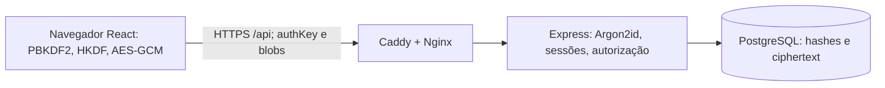

# Chave Mestra

Gerenciador de senhas didático com criptografia no navegador. O servidor autentica e armazena apenas dados cifrados. Implementação baseada em [requisitos](docs/01-requisitos.md), [contrato criptográfico](docs/02-criptografia.md), [frontend](docs/03-frontend.md) e [backend](docs/04-backend.md). O design segue as [diretrizes visuais](docs/05-diretrizes-frontend.md).

## Arquitetura



Senha mestra e chave do cofre permanecem no navegador. PBKDF2 com 600.000 iterações deriva uma chave mestra temporária; HKDF separa KEK e authKey. A KEK embrulha a chave aleatória do cofre. AES-256-GCM cifra cada item com IV novo e AAD contendo IDs de usuário e item. O backend aplica Argon2id ao authKey e armazena somente seu hash. Sessões usam token opaco em cookie `HttpOnly; Secure; SameSite=Strict`, hash no banco, expiração por inatividade e teto absoluto.

O modelo de ameaça cobre vazamento de banco, usuário autenticado malicioso, interceptação de rede e força bruta online. JavaScript malicioso servido por um servidor comprometido, malware local, rollback e remoção de itens ficam fora da proteção do beta. Perder a senha mestra torna o cofre irrecuperável.

## Usar sem conta

Nas telas de entrada, **Continuar sem conta** abre um cofre visitante. O navegador gera uma chave AES-GCM temporária; as credenciais são cifradas e ficam apenas na memória da aba, sem chamadas de API para cadastro ou itens. É possível criar, buscar, editar, excluir e copiar credenciais e usar o gerador. Sair, recarregar, fechar a aba ou atingir o tempo de inatividade apaga a chave e os itens. Esse modo é útil para experimentar o aplicativo; os itens temporários não são transferidos ao criar uma conta depois.

## Rodar localmente

Requisitos: Docker Engine e Compose v2. Copie `.env.example` para `.env` e substitua `POSTGRES_PASSWORD` e `PRELOGIN_SECRET` por valores aleatórios longos. Então:

```sh
docker compose up --build
```

Acesse **https://localhost:8443**. O Caddy cria um certificado local; o navegador pode exigir aceitar a autoridade local. A API fica em `/api`, e `/api/health` verifica a conexão com o banco. As migrações são aplicadas na inicialização da API. Os dados ficam no volume `db_data`.

Para desenvolvimento manual, use Node.js 20+ em `backend/` e `frontend/`: `npm ci`, `npm run dev`. O backend precisa das variáveis de `backend/.env.example` no ambiente e de PostgreSQL 15+. O Vite encaminha `/api` para `localhost:3000`. Para testar cookies seguros e Web Crypto no fluxo completo, prefira o Compose com HTTPS.

## Simulador de arquitetura no terminal

O [simulador](simulator/README.md) demonstra cadastro, login, cofre cifrado,
adulteração, troca da senha mestra, autorização, sessões, força bruta e modo visitante.
Ele reutiliza a criptografia do frontend e mantém API e banco simulados em memória.

```sh
cd simulator
npm ci
npm start
```

Use `npm run demo` para executar todos os cenários sem interação.

## Testes e build

Em cada diretório, `npm run typecheck`, `npm test` e `npm run build`. No frontend, `npm run format` e `npm run format:check` mantêm o código legível. Testes do backend exigem PostgreSQL e `DATABASE_URL`, `PRELOGIN_SECRET`, `ALLOWED_ORIGIN`; o CI fornece esses valores. O teste de integração cobre autenticação, hash Argon2id, isolamento entre usuários, conflito de versão, bloqueio, logout e validação de IV. O front testa AAD, adulteração, troca de senha mestra e gerador.

## CI/CD

[`.github/workflows/pipeline.yml`](.github/workflows/pipeline.yml) executa typecheck, testes, build e `npm audit` para dependências de produção em PRs e pushes. Em `main` e tags `v*`, publica imagens `api` e `web` no GHCR, marcadas pelo SHA do commit.

Para ativar o deploy automático de `main`, configure no GitHub a variável `DEPLOY_ENABLED=true` e os secrets `DEPLOY_HOST`, `DEPLOY_USER`, `DEPLOY_DIR`, `DEPLOY_SSH_KEY`, `DEPLOY_KNOWN_HOSTS` no ambiente `production`. O servidor precisa de Docker Compose, acesso de leitura às imagens do GHCR (`docker login ghcr.io` caso privadas), DNS apontado para ele e portas 80/443 livres. Crie em `DEPLOY_DIR/.env` os valores de `.env.example` com `DOMAIN`, `ALLOWED_ORIGIN=https://DOMINIO`, `POSTGRES_PASSWORD` e `PRELOGIN_SECRET`. O job copia `compose.prod.yml`, Caddyfile e `infra/deploy.sh`, puxa as imagens e aplica `docker compose up -d`. O script verifica a saúde da API e do front; se falharem, tenta restaurar a imagem anterior. O Caddy obtém TLS público automaticamente. O banco usa volume persistente; faça backup desse volume antes de mudanças de esquema.

Sem host e secrets de produção, CI e publicação de imagens funcionam; o job de deploy fica desativado. Isso permite desenvolver e revisar manualmente antes de ligar a entrega automática.

## Estrutura

- [Backend: mapa do código](backend/README.md): `app.ts` compõe a API; rotas, serviços, validação e middlewares ficam em diretórios próprios.
- `backend/src/db/`: conexão, executor de migrações e SQL versionado.
- `frontend/src/crypto/`: contrato criptográfico e gerador.
- `frontend/src/state/`: chave em memória e bloqueio automático.
- `frontend/src/api/`: cliente HTTP tipado.
- [Frontend: mapa do código](frontend/README.md): componentes compartilhados, layouts, páginas por área, serviços e CSS em `src/styles/`.
- [Banco: inicialização e migrações](database/README.md): ordem dos scripts e responsabilidades de cada caminho de criação do esquema.
- [Infraestrutura: mapa de execução](infra/README.md): Caddy, Nginx, Dockerfiles, deploy e pendências de configuração.

## Operação manual

`docker compose ps` mostra serviços; `docker compose logs -f api` mostra eventos sem corpos sensíveis. Em produção, use `IMAGE_REPOSITORY=owner/repo IMAGE_TAG=<sha> bash infra/deploy.sh` no diretório de deploy. Para voltar manualmente a uma versão, defina `IMAGE_TAG` como um SHA anterior. Migrações são aditivas nesta versão; futuras migrações que alterem dados exigem plano específico de rollback.
